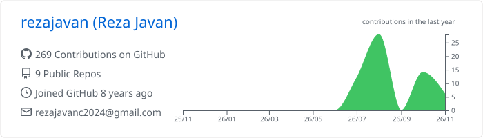
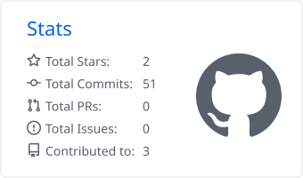
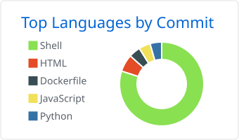

<h1 align="center">Hi, I'm Reza Javan 👋</h1>

  <b>Data Engineering &amp; Data Science</b> · Building pipelines, learning from data

  
  

---

### 🧭 About me

- 📍 Tehran, Iran
- 🎓 M.Sc. Electrical Engineering, **Sharif University of Technology**
- 🏆 Ranked **1st among 15,000+** in Iran's national M.Sc. entrance exam (Electrical Engineering)
- 🌱 Currently growing in **data engineering** and **data science**

### 🛠️ Tech I work with

**Languages & Data**

  
  
  
  
  
  
  

**Infrastructure & Visualization**

  
  
  
  
  

### 📊 GitHub stats

<!-- These images are generated daily by .github/workflows/stats.yml -->

  

  
  

  <picture>
    <source media="(prefers-color-scheme: dark)" srcset="https://raw.githubusercontent.com/rezajavan/rezajavan/output/github-snake-dark.svg">
    
  </picture>

### 📚 Publications

- *SCALHEALTH: Scalable Blockchain Integration for Secure IoT Healthcare Systems*
- *A Scalable Multi-Layered Blockchain Architecture for Enhanced EHR Sharing and Drug Supply Chain Management*

---

<i>Thanks for stopping by — feel free to explore my repositories.</i>

